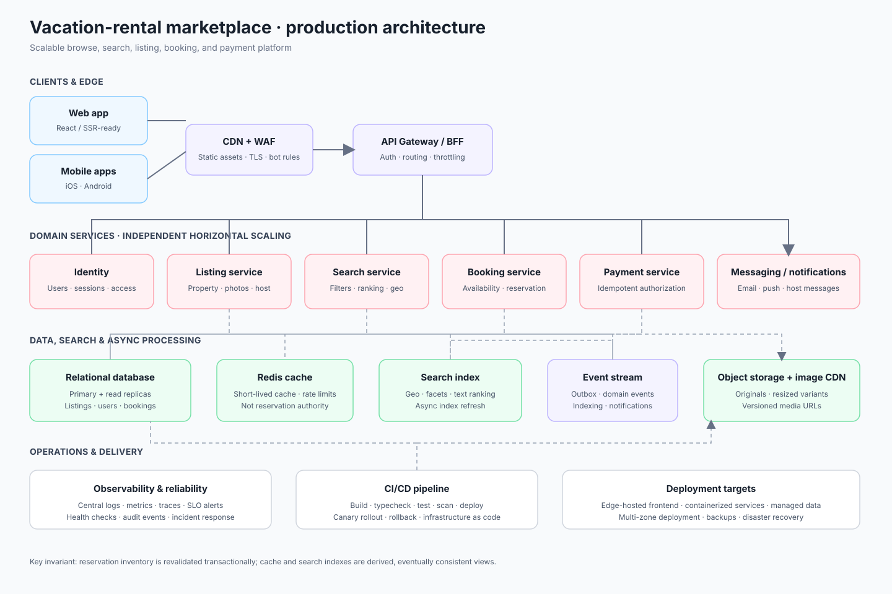

# Production Marketplace Architecture

The submitted clone remains a focused, frontend-only implementation. This diagram describes a plausible production-scale vacation-rental marketplace architecture, as requested by the assignment.

## Scaling notes

- Serve the React application and versioned static assets through a CDN; keep media on object storage behind an image CDN with responsive transforms.
- Route authenticated requests through an API gateway/BFF to independently scalable listing, search, booking, payment, and identity services.
- Use a relational database as the source of truth for listings, users, and reservations; add read replicas for browse-heavy traffic and a transactional outbox/event stream for downstream indexing and notifications.
- Keep search documents in a dedicated search index, refreshed asynchronously from listing events. Use Redis for short-lived availability, rate-limit, and session caches, never as the booking source of truth.
- Make booking and payment flows idempotent. Confirm reservations only after inventory is revalidated and payment authorization succeeds.
- Deploy services and frontend through CI/CD with staged rollout, health checks, centralized logs, metrics, traces, and alerting.
